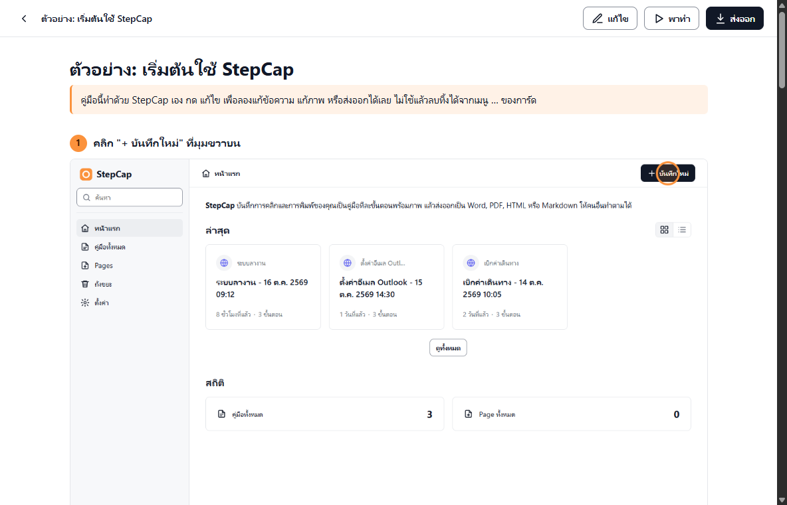
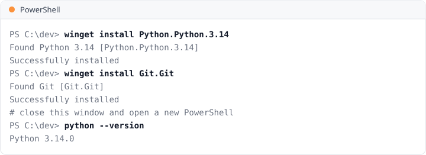
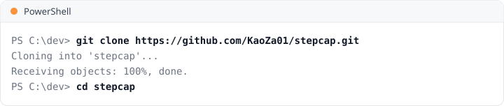
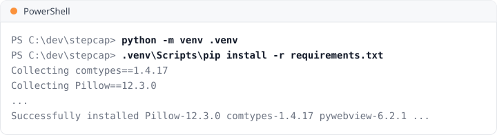
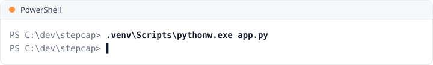
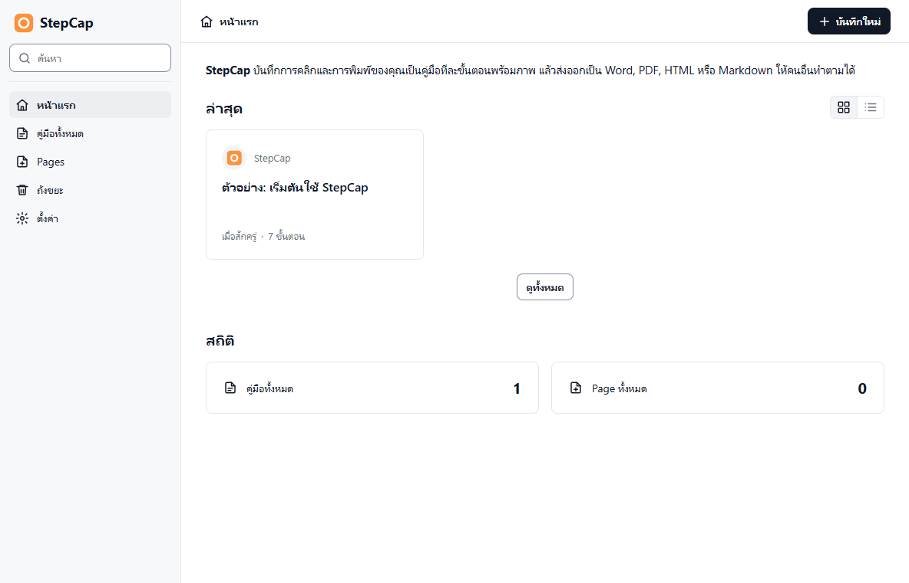
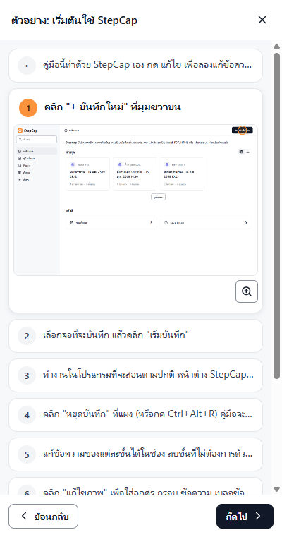

# StepCap

บันทึกการคลิกและการพิมพ์บนหน้าจอให้เป็นคู่มือทีละขั้นตอนพร้อมภาพ แล้วส่งออกเป็น Word, PDF, HTML หรือ Markdown
เหมาะกับการทำ SOP และคู่มือสอนใช้งานโปรแกรมให้เพื่อนร่วมงาน ทุกอย่างทำงานในเครื่อง ไม่ส่งข้อมูลออกไปที่ไหน

*StepCap turns your clicks and typing into a step-by-step guide with screenshots, exported as Word, PDF, HTML or Markdown. Windows only, runs fully offline. The app speaks Thai or English: Settings > ภาษา / Language.*



## ทำอะไรได้บ้าง

- **บันทึก** ทุกคลิก การพิมพ์ และปุ่มลัด เป็นขั้นตอนพร้อมภาพหน้าจอที่มีวงตรงจุดที่คลิก
- **แก้ไข** ข้อความแต่ละขั้น เรียงลำดับใหม่ เพิ่มหมายเหตุหรือภาพเอง
- **แก้ภาพ** วาดลูกศร กรอบ ข้อความ เบลอ ปิดดำ และครอปภาพ
- **ซ่อนข้อมูลอัตโนมัติ** เบลออีเมล เบอร์โทร เลขบัตรประชาชน เลขบัตร และเลขบัญชีในภาพ
- **พาทำ** เปิดคู่มือแล้วให้โปรแกรมชี้ปุ่มบนจอจริงทีละขั้น คลิกโดนแล้วไปขั้นต่อไปเอง
- **Page** รวมหลายคู่มือเป็นเอกสารเดียว
- **ส่งออก** เป็น Word (.docx), PDF, HTML (ไฟล์เดียวเปิดได้ทุกที่) หรือ Markdown (.zip)

## ต้องมีอะไรบ้าง

- Windows 11 (ทดสอบบน Windows 11) พร้อม Microsoft Edge WebView2 Runtime ซึ่ง Windows 11 มีให้อยู่แล้ว
- ถ้ารันจากซอร์ส ต้องมี Python 3.14 เพิ่ม

## วิธีติดตั้ง (Setup guide)

### ผู้ใช้ทั่วไป: ใช้ไฟล์ติดตั้ง

ไม่ต้องลง Python และไม่ต้องใช้สิทธิ์ admin

1. ดาวน์โหลดไฟล์ `StepCap-Setup-<version>.exe` จากหน้า [Releases](https://github.com/KaoZa01/stepcap/releases/latest)
2. ดับเบิลคลิกไฟล์ที่ดาวน์โหลดมา
3. ถ้าขึ้นหน้าจอสีน้ำเงิน "Windows protected your PC" ให้กด **More info** แล้วกด **Run anyway**
   (ขึ้นเพราะไฟล์ยังไม่ได้เซ็นใบรับรองจาก Microsoft ไม่ใช่ไวรัส)
4. เลือกภาษา **ไทย** หรือ **English** แล้วกด **ตกลง** StepCap จะใช้ภาษานี้ตอนเปิดครั้งแรก
5. กด **ถัดไป** เลือกว่าจะให้มีไอคอนบนเดสก์ท็อปหรือไม่ แล้วกด **ติดตั้ง**
   - ถ้า StepCap เปิดค้างอยู่ ตัวติดตั้งจะขอให้ปิดก่อน
   - ถ้าเครื่องไม่มี WebView2 ตัวติดตั้งจะแจ้งให้ลงก่อน
6. กด **เสร็จสิ้น** StepCap จะเปิดขึ้นมา ครั้งต่อไปเปิดได้จากเมนู Start หรือไอคอนบนเดสก์ท็อป

โปรแกรมติดตั้งไว้ที่ `%LOCALAPPDATA%\Programs\StepCap` เฉพาะผู้ใช้คนนั้น
ติดตั้งรุ่นใหม่ทับได้เลย ถ้าจะถอนการติดตั้งให้ไปที่ **Settings > Apps > StepCap > Uninstall** (คู่มือใน `Documents\StepCap` จะยังอยู่)

ถ้าจะส่งไฟล์ติดตั้งให้เพื่อนร่วมงาน มีข้อความวิธีติดตั้งสองภาษาให้คัดลอกไปส่งพร้อมไฟล์ใน [docs/install-guide.md](docs/install-guide.md)

### นักพัฒนา: รันจากซอร์ส

เปิด PowerShell แล้วทำตามทีละขั้น

**1. ลง Python 3.14 และ Git**

```powershell
winget install Python.Python.3.14
winget install Git.Git
```

ลงเสร็จแล้วให้ปิดหน้าต่าง PowerShell แล้วเปิดใหม่ เพื่อให้เรียกคำสั่ง `python` และ `git` ได้ จากนั้นพิมพ์ `python --version` ต้องขึ้น `Python 3.14` (จะโหลดตัวติดตั้งจาก python.org แทนก็ได้ แต่ต้องติ๊ก "Add python.exe to PATH")



**2. ดึงโค้ด**

```powershell
git clone https://github.com/KaoZa01/stepcap.git
cd stepcap
```



**3. สร้าง venv แล้วลงไลบรารี**

```powershell
python -m venv .venv
.venv\Scripts\pip install -r requirements.txt
```

ขึ้น `Successfully installed ...` แปลว่าเสร็จ



**4. เปิด StepCap**

```powershell
.venv\Scripts\pythonw.exe app.py
```

หน้าต่าง StepCap จะเปิดขึ้นมา (terminal ไม่แสดงอะไรต่อ) ถ้ามี StepCap ที่ติดตั้งจากไฟล์ exe เปิดอยู่ ให้ปิดก่อน เพราะทั้งสองใช้โฟลเดอร์คู่มือเดียวกันและเปิดพร้อมกันไม่ได้





ครั้งต่อไปเปิดได้ด้วยคำสั่งขั้นที่ 4 จากโฟลเดอร์ `stepcap`

### หลังติดตั้ง

กดปุ่ม X แล้ว StepCap จะย่อไปอยู่ที่ไอคอนสีส้มในแถบ tray ที่มุมขวาล่าง ถ้าจะปิดโปรแกรมจริงให้คลิกขวาที่ไอคอนนั้นแล้วเลือก "ออก"

## วิธีใช้แบบสั้น


1. กด **+ บันทึกใหม่** เลือกจอ แล้วกด **เริ่มบันทึก**
2. ทำงานในโปรแกรมที่จะสอนตามปกติ
3. กด **หยุดบันทึก** ที่แผงมุมขวาล่าง คู่มือจะเปิดให้แก้ไขทันที
4. กด **ส่งออก** แล้วเลือกรูปแบบไฟล์

**พาทำ:** เปิดคู่มือแล้วกด **พาทำ** แผงจะขึ้นชิดขอบขวาของจอ แสดงขั้นปัจจุบันพร้อมภาพ และมีกรอบสีส้มรอบปุ่มที่ต้องคลิก
ถ้าหาปุ่มไม่เจอแต่เจอหน้าต่าง จะชี้ตำแหน่งโดยประมาณ ขั้นที่ต้องพิมพ์จะไปต่อเองเมื่อพิมพ์ตรงกับที่อัดไว้ ขั้นกดปุ่มหรือปุ่มลัดไปต่อเมื่อกดปุ่มนั้น
ส่วนรหัสผ่าน ข้อความที่ถูกซ่อน และคู่มือที่อัดก่อนมีพาทำ จะไปต่อเมื่อกด Enter หรือ Tab (กด **ถัดไป** เองได้เสมอ)
คู่มือที่บันทึกก่อนมีพาทำจะชี้ตามตำแหน่งเดิมบนจอที่เลือกไว้ ระหว่างพาทำจะเริ่มบันทึกไม่ได้



เปิดครั้งแรกจะมีคู่มือ "ตัวอย่าง: เริ่มต้นใช้ StepCap" อยู่ในคลัง และมีคำแนะนำสั้น ๆ ชี้ปุ่มสำคัญ ดูคำแนะนำซ้ำได้ที่ **ตั้งค่า > แสดงคำแนะนำอีกครั้ง**

เปลี่ยนภาษาเป็นภาษาอังกฤษได้ที่ **ตั้งค่า > ภาษา / Language** ข้อความขั้นตอนที่บันทึกใหม่และหัวข้อในไฟล์ที่ส่งออกจะเป็นภาษาที่เลือก ส่วนคู่มือที่ทำไว้แล้วไม่ถูกแปล

| ปุ่มลัด | ใช้ทำอะไร |
|---|---|
| Ctrl+Alt+R | เริ่ม / หยุดบันทึก |
| Ctrl+Alt+P | พัก / ทำต่อ |

## ไฟล์เก็บที่ไหน

คู่มือเก็บอยู่ที่ `Documents\StepCap` เปิดโฟลเดอร์นี้ได้จากหน้า **ตั้งค่า > เปิดโฟลเดอร์**

> **ข้อควรระวัง:** โฟลเดอร์นี้มีภาพต้นฉบับก่อนเบลอด้วย ถ้าจะส่งคู่มือให้คนอื่น ให้ส่งเฉพาะไฟล์ที่กดส่งออก อย่าส่งทั้งโฟลเดอร์
> ส่วนที่ซ่อนข้อมูลอัตโนมัติอ่านได้เฉพาะตัวอักษรอังกฤษและตัวเลข ควรตรวจภาพอีกครั้งก่อนส่งต่อทุกครั้ง

ดูแนวทางดีไซน์ได้ที่ [DESIGN.md](DESIGN.md)

## สัญญาอนุญาต

MIT ดูรายละเอียดที่ [LICENSE](LICENSE)
